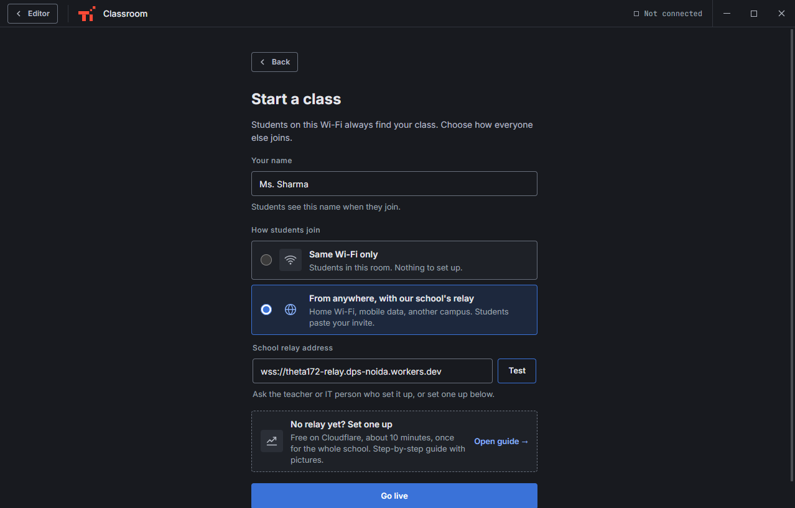
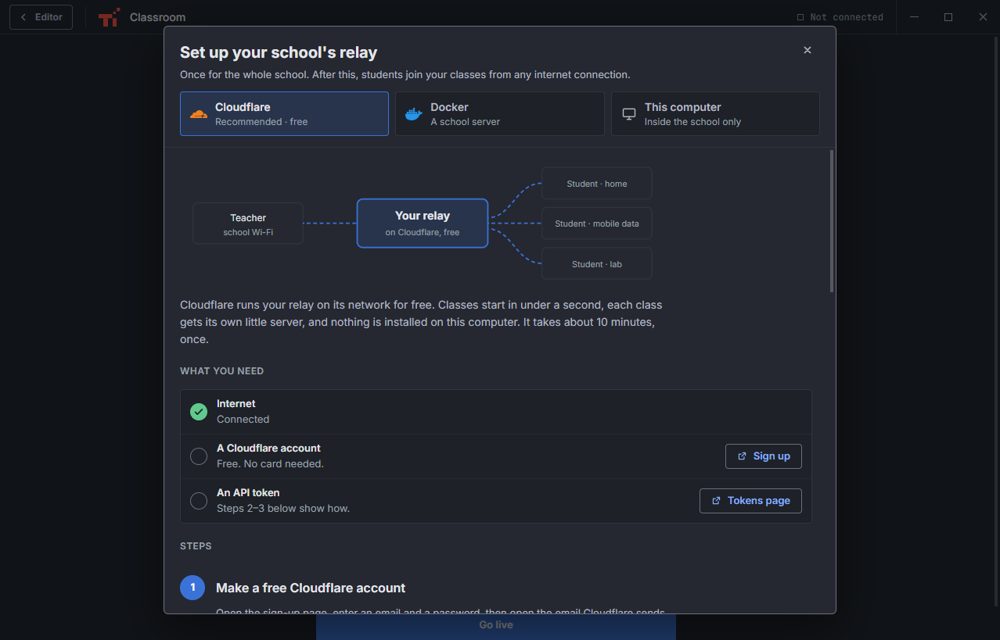
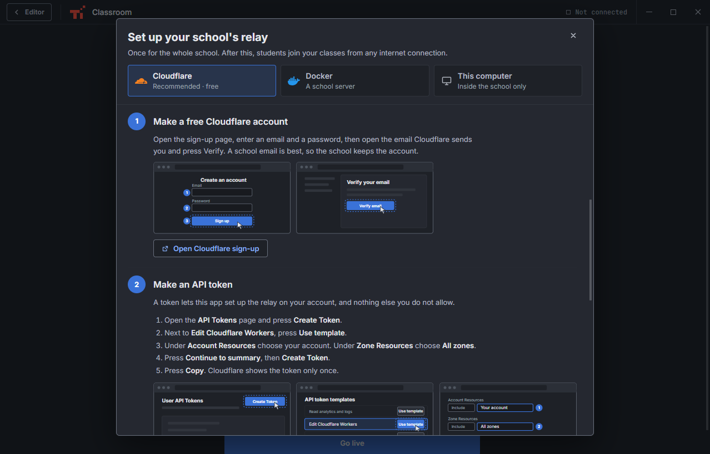
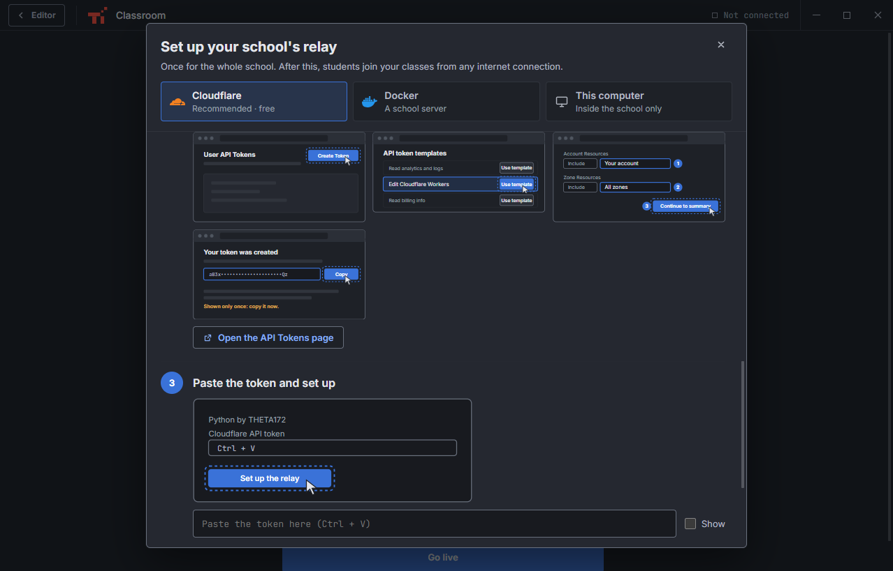
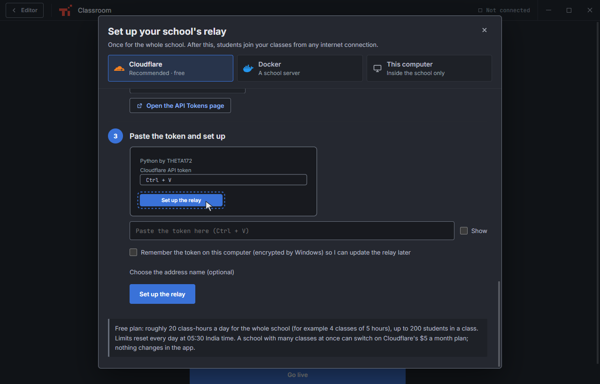
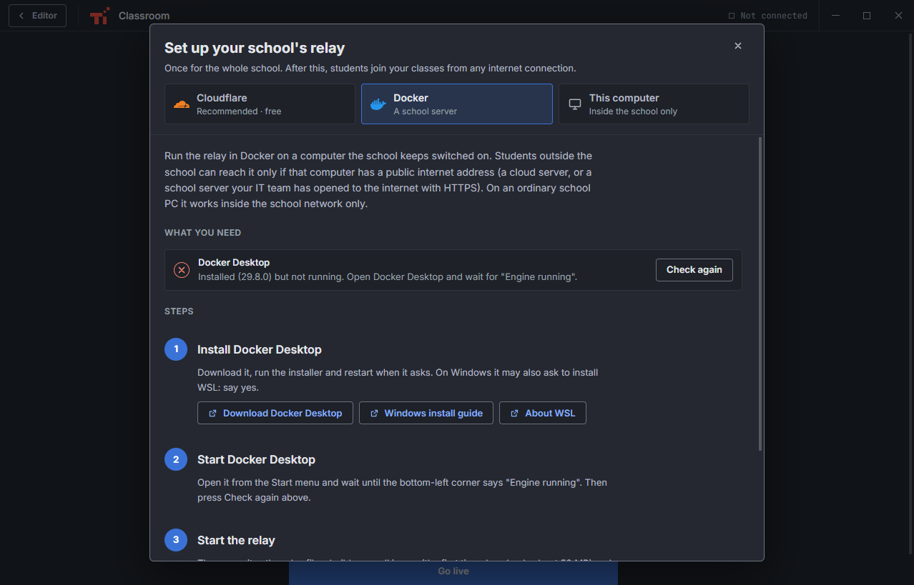
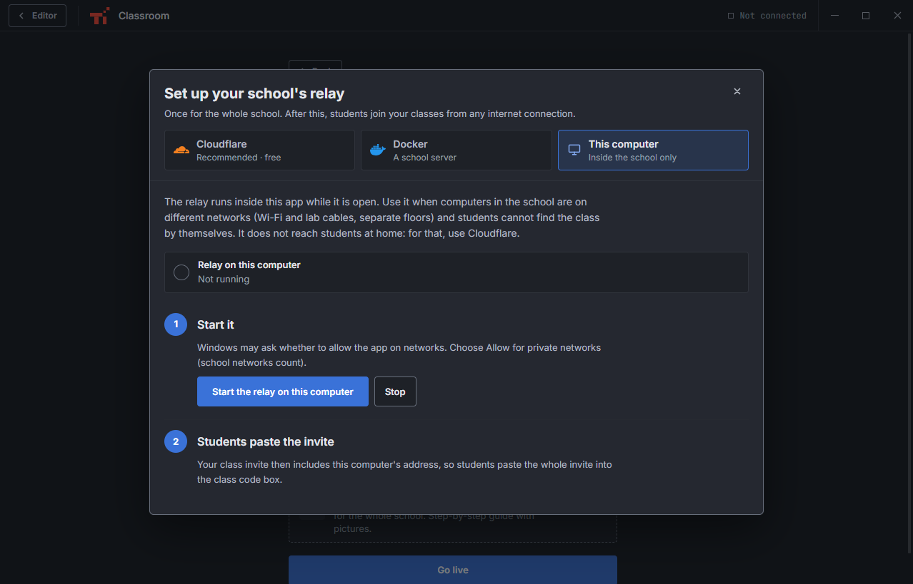
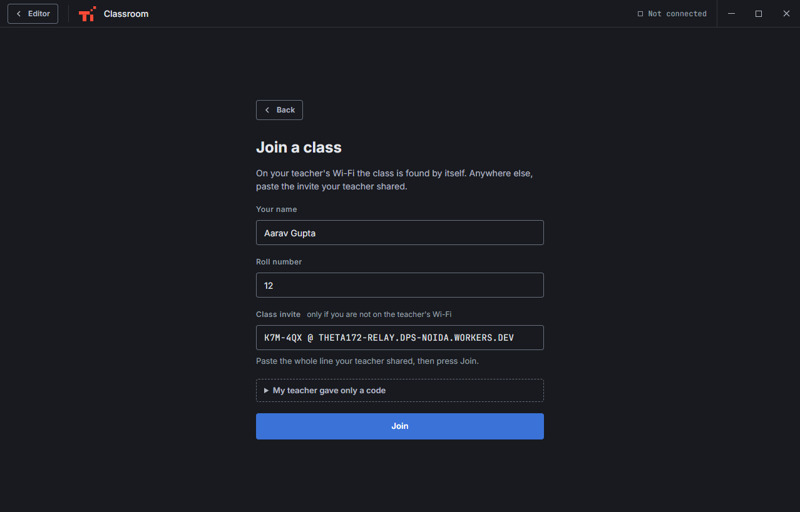

# Classes from any internet connection

Python by THETA172 classes work in three ways. The teacher picks one under
**Classroom → Start a class → How students join**.

| Way | Who can join | Set-up |
|---|---|---|
| **Same Wi-Fi only** | Students on the teacher's network | Nothing |
| **From anywhere, with our school's relay** | Anyone with internet: home Wi-Fi, mobile data, another campus | Paste the school's relay address once |
| **No relay yet? Set one up** | — | A guide in the app sets up the relay (free, about 10 minutes, once per school) |

Students on the teacher's Wi-Fi always find the class by themselves, in every mode.



## What a relay is

The teacher's app and every student's app each open an outgoing connection to
the relay, and the relay passes class messages between them. Nobody has to
open ports at school or at home, and a dropped connection reconnects by itself
(the relay keeps the class for 60 seconds and a student's seat for 45 seconds).
The relay stores nothing.

One relay serves the whole school: every teacher pastes the same address.

## Set up a relay (Cloudflare, recommended)

Free, fast everywhere in India, and nothing to install or keep running. Each
class runs on its own small Cloudflare server near the teacher.

Open **Classroom → Start a class → No relay yet? Set one up**.



The guide checks the internet connection first. Then:

### 1. Make a free Cloudflare account

Press **Open Cloudflare sign-up**, enter an email and a password, and press
**Verify** in the email Cloudflare sends. A school email is best, so the school
keeps the account. No card is needed.



### 2. Make an API token

The token lets the app set up the relay on your account.

1. Press **Open the API Tokens page**, then **Create Token**.
2. Next to **Edit Cloudflare Workers**, press **Use template**.
3. Under **Account Resources** choose your account; under **Zone Resources** choose **All zones**.
4. Press **Continue to summary**, then **Create Token**.
5. Press **Copy**. Cloudflare shows the token only once.



### 3. Paste the token and press **Set up the relay**



The app then does five things and shows each one:

1. checks the token and finds your account;
2. gets your free `workers.dev` address (it makes one if the account has none);
3. uploads the class relay;
4. switches the address on;
5. runs a test class through it.

When it says **Your relay is ready**, the address (for example
`wss://theta172-relay.dps-noida.workers.dev`) is saved as your school relay.
Give it to the other teachers.

A brand-new `workers.dev` address can take a few minutes to start working. If
the guide says **Almost there**, wait a few minutes and press **Test again**.

The token is used only for these steps. It is kept only if you tick
**Remember the token on this computer**; it is then encrypted by Windows.

**Free plan limits.** Roughly 20 class-hours a day for the whole school, up to
200 students in a class. The limits reset every day at 05:30 India time. A
school with many classes at the same time can switch on Cloudflare's $5 a
month plan; nothing changes in the app.

## Other ways to run the relay

### Docker (a school server)

For a server the school keeps switched on. Students outside the school can
reach it only if that computer has a public internet address (a cloud server,
or a school server your IT team has opened to the internet with HTTPS).

The **Docker** tab checks whether Docker Desktop is installed and running. It
links to the download if it is missing, then builds and starts the relay on port
8787. It also writes the relay folder, so the relay can be copied to a cloud
server:

```sh
docker build -t theta172-relay .
docker run -d --restart unless-stopped -p 8787:8787 theta172-relay
```



### This computer

The relay runs inside the app while it is open. Use it when the school's
computers are on different networks (Wi-Fi and lab cables, separate floors)
and students cannot find the class by themselves. It does not reach students
at home.



## Students: joining from anywhere

The teacher's class shows an **Invite** such as
`K7M-4QX @ theta172-relay.dps-noida.workers.dev`. The teacher presses **Copy invite** and
shares it (WhatsApp, the board, the school portal).

Students open **Classroom → Join a class**, type their name and roll number,
paste the whole invite into **Class invite**, and press **Join**. The app
remembers the school's relay, so next time the short code alone is enough.



## For developers

- `electron/relay-core.cjs` holds the relay's rules. It is shared by
  `electron/relay-node.cjs` (the Docker relay and "this computer") and by the
  Cloudflare Worker (`electron/relay-worker.js`, one Durable Object per class).
- `electron/cloudflare-deploy.cjs` uploads the Worker through Cloudflare's API:
  it checks the token, sets up the `workers.dev` subdomain, uploads the script
  with the `ClassRoom` Durable Object binding and the `v1` migration, and
  switches on the `workers.dev` route.
- `relay-server/` runs the same relay on any Node.js 18+ host. `GET /health`
  answers `{ ok: true, relay: "theta172" }`.
- Paths: `/host` opens a new class; `/room/CODE` joins or resumes one. The Node relay
  accepts any path.
- Tests: `tests/relay-cloud.test.js` (simulated Worker runtime, fake Cloudflare
  API, invites, Node relay) and `tests/classroom-network.test.js`.
